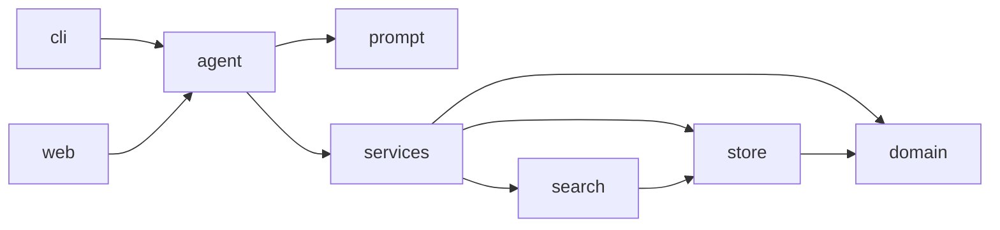

# emporio-agent

**Mel** is a text customer-service agent for Empório da Música, a fictional instrument store in
Campo Grande/MS. She keeps the store's persona, answers only from the store's data and policy
manual, knows when to look up data and when to read a policy, and politely turns away anything out
of scope. One PydanticAI agent, four tools, everything else in plain Python.

## Run it

Needs [uv](https://docs.astral.sh/uv/) and Python 3.12.

```bash
uv sync
cp .env.example .env   # then set OPENROUTER_API_KEY (https://openrouter.ai/keys)
uv run python -m emporio.cli                                      # chat in the terminal
uv run uvicorn emporio.web:app --host 127.0.0.1 --port 7932       # or in the browser
```

`.env` also takes `MODEL` (default `openrouter:deepseek/deepseek-v4.1-flash`) and `EMPORIO_NOW`,
the store clock (default `2026-03-25T10:00-04:00`, three days after the last order; `now` for the
real clock).

**Or let an AI coding assistant set it up.** Paste this into Claude Code (or a similar tool):

```text
Clone https://github.com/rodrigotriboni1/emporio-agent and set it up following its README:
install uv if it is missing, run `uv sync`, copy `.env.example` to `.env`, and run `uv run pytest`.
Then stop and ask me to paste my OpenRouter API key into `.env` myself; never ask for the key in
chat, print it or commit it. Once I confirm, start the web chat with
`uv run uvicorn emporio.web:app --host 127.0.0.1 --port 7932` and tell me to open
http://127.0.0.1:7932.
```

Tests: `uv run pytest` (no LLM calls, runs in CI). `uv run python scripts/scenarios.py` replays five
scripted conversations on the real model and checks them; `uv run python scripts/spike.py` compares
models. Both spend a few cents of OpenRouter credit.

## Example conversations

Generated by `scripts/scenarios.py` from a run where every check passed; not edited by hand.

- [01 Catalog search](examples/01-catalog-search.md): guitars up to R$ 1000, then electro-acoustics in the same range.
- [02 Price, payment and store info](examples/02-price-payment-and-store-info.md): Takamine GD20 price and installments, hours, address, payment.
- [03 Return after the regret window](examples/03-return-after-regret-window.md): order checked, rule applied, human handoff after the customer agrees.
- [04 Late order](examples/04-late-order.md): apology, tracking and delay; another customer's order reveals nothing.
- [05 Out of scope](examples/05-out-of-scope.md): accessories refused, off-topic, a discount injection, a prompt-leak attempt.

## How it works

The model never does arithmetic and never decides who may see an order. It picks one of four
tools and phrases the answer; the tools return text that is already computed.

| Tool | What it does |
|---|---|
| `search_products(query, category, max_price)` | Catalog, price, PIX price, stock, installments. Tolerates accents, typos and plurals. |
| `get_policy(topic)` | One whole section of the store manual (hours, payment, returns, shipping…). For hours it also says until when the store is open today. |
| `get_order(order_id, phone_or_email)` | Checks the customer's phone or e-mail on every call, then explains status, tracking, delay and return windows. |
| `handoff_to_human(reason, summary)` | Records the case for the team with a protocol number, personal data masked (only after the customer agrees). |



`domain.py` holds every business rule (prices, installments, shipping, return windows, opening
hours) as plain, unit-tested functions. `store.py` loads the CSVs and the manual. `services.py`
runs the four tools and enforces order access and data masking. `agent.py` is the only file that
knows about PydanticAI.

## How I approached it

1. **Read the material first.** The brief, the manual and the CSVs disagree in 20 places. Each got
   one written assumption (table below) before any code.
2. **Decide what the model must not do.** Anything that must be exact went into tested code, so
   the model only routes and writes.
3. **Treat order data as private.** Every order lookup needs the order number plus that customer's
   phone or e-mail; nothing about a customer is remembered between calls.
4. **Choose by evidence.** Framework from a sourced comparison, model from a live test with the
   selection rule written down before the run.
5. **Make behaviour checkable.** Scripted conversations run on the real model with automatic
   checks; only a passing run produces the examples above.
6. **Cut what was not asked for.** A WhatsApp channel was built and then parked on the
   [`feature/whatsapp-channel`](https://github.com/rodrigotriboni1/emporio-agent/tree/feature/whatsapp-channel)
   branch to keep this simple.

## Decisions

- **Framework: PydanticAI.** Native OpenRouter support, a built-in web chat UI, and test models
  that run the agent without calling an LLM. Google ADK, OpenAI Agents SDK, Vercel AI SDK and
  LangChain were compared in `docs/research/2026-11-02-python-agent-framework.md`.
- **Model: DeepSeek V4.1 Flash via OpenRouter.** Three models ran the real agent on nine scripted
  turns ([full results](docs/spike-results.md)). Rule fixed beforehand: best tool accuracy, then
  speed, then cost. Any OpenRouter model can be swapped in through `MODEL`.

  | Model | Tool accuracy | Median latency | Cost of the run |
  |---|---|---|---|
  | DeepSeek V4.1 Flash | 100% | 2.2 s | US$ 0.004 |
  | Gemini 3.8 Flash | 100% | 11.2 s | US$ 0.046 |
  | Claude Sonnet 5.5 | 89% | 4.6 s | US$ 0.101 |

- **Prompt strategy.** Instructions in English, replies in the customer's language (PT-BR by
  default), in four short sections that match the brief: persona, grounding, tool routing, scope.
  Today's date is added on every run. Rules that must never break (prices, order access, masking,
  limits) are in code, not in the prompt.
- **No RAG.** The manual is about 2,500 tokens in nine topics, so `get_policy` returns the whole
  section by name. Similarity search would only add ways to fetch the wrong section ("prazo" can
  mean delivery, return or warranty) and chunking would split rules that belong together. Products
  and orders are tables, served by exact filters.
- **Manual transcribed once.** The policy PDF was turned by hand into `data/politicas.md`, split by
  topic, with a note wherever the PDF contradicts itself. No PDF parsing at runtime.
- **History in memory only.** Conversations stay in the CLI process or the browser tab. Storing
  them would mean keeping customers' personal data on disk.
- **Limits.** Messages over 2,000 characters, turns over 10 model calls and conversations over
  40,000 characters are stopped with a polite fixed reply, in every interface.
- **Not built, on purpose:** multi-agent routing, text-to-SQL (the model could read any customer's
  rows), a classifier in front of Mel (the code already blocks what it would block, at the cost of
  an extra model call per message), a custom UI, Docker.
- **Reading of the brief:** "the simplest way possible" as the minimal core above; "all responses
  in English" as code and docs in English while Mel answers customers in their own language.

## Data inconsistencies

<details>
<summary>20 places where the manual and the data disagree, and the assumption taken for each</summary>

| Inconsistency | Assumption |
|---|---|
| The manual lists (67) 3341-4444 as "Telefone / WhatsApp", but section 7 names (67) 3321-4500 as WhatsApp. | 3341-4444 is the phone, 3321-4500 is WhatsApp. |
| The store e-mail has an accent in one place and not on the cover. | The unaccented address. |
| The installment table (section 3) disagrees with the rules in section 3.1. | 3.1 wins: up to 3x, 4x–6x with installments of at least R$ 80, 7x–12x of at least R$ 100. |
| "Exceto abaixo de R$ 50,00" is ambiguous. | Purchases below R$ 50 are not split. |
| "Mais de 300 instrumentos", but the catalog has 65. | Mel never states a catalog size. |
| Woodwind, brass and orchestral-string categories have no products. | "Nothing available right now", never "we don't sell it". |
| The manual says to suggest partner stores, but there is no partner list. | No partner store is ever named. |
| Product 136 is discontinued but has stock 13. | Status beats stock: not sold, alternatives offered. |
| Product 130 is "coming soon" but appears in past orders. | Not sold now; past orders shown as recorded. |
| Products 135–144: names contradict descriptions. | Name and specs are trusted; descriptions are never shown. |
| Product 96 is active with stock 0. | Unavailable, alternatives offered, no reservation. |
| Orders 9, 16 and 18 break the installment minimums. | Shown as recorded; rules apply to new quotes. |
| PIX orders 1, 5, 10, 13 and 17 have no PIX discount. | Totals shown as recorded, never recomputed. |
| Order 11 ignores an active promotion. | Total shown as recorded. |
| Orders 3 and 20: total differs from the sum of items. | Total shown as recorded. |
| Local deliveries carry postal tracking codes, though the manual says motoboy. | Only the tracking code is given, never the carrier. |
| Customers 11 and 43 share an e-mail. | Access is checked against the order's own customer. |
| No delivered-at date. | The estimated delivery date is used for return windows. |
| No sales-channel column, but the regret right applies to online sales only. | All orders treated as online. |
| The manual does not say when the 7-day exchange window starts. | From delivery. |

</details>

The price filter compares against the lowest price the customer can pay: that is why a
R$ 1.049,00 guitar (R$ 996,55 via PIX) shows up under "até R$ 1000" in example 01.

## Limitations and next steps

- Holidays are not modelled; shipping outside Campo Grande is not quoted (Mel asks for a CEP
  quote instead of inventing one).
- The lock after five wrong order lookups lives in memory and resets on restart.
- In the web UI, a provider error (bad key, rate limit) reaches the browser unformatted.
- Next, in order of need: saved conversations with encryption and retention; a real ticket queue
  for handoffs; RAG only if the manual grows large; traces and cost monitoring.
- Designed but not built: **multiple stores** (a store id from the request, never from the model,
  with each store's own data, manual and prices) and **partner referral** (partners as data served
  by a tool, a referral opening a new conversation at that store without carrying the customer's
  data). The WhatsApp channel's design is in `docs/research/2026-11-03-whatsapp-integration.md`.

## How it was built with AI

Built with **Claude Code** (Claude Opus). I made the product and design calls; the assistant
researched, wrote the code and reviewed it.

- **Design:** a brainstorming session over the brief and the data, then two rounds where the
  assistant challenged every decision (`docs/superpowers/specs/`).
- **Research:** agents compared frameworks and WhatsApp options against primary sources
  (`docs/research/`).
- **Build:** a local pipeline of agents took each GitHub issue through spec, code, automated checks
  (the same as CI), parallel reviews (code always; security, UX and UI when relevant) and an
  approval step. Anything touching the prompt, the examples, the model or access control came back
  to me to decide. 15 issues, about 30 merged pull requests.
- **Evaluation:** two independent evaluator agents graded the repo against the brief; their
  findings became issues and went through the same pipeline.
- The reviews caught real bugs (a size limit that could be bypassed, masking that missed accented
  names, a wrong opening-hours sentence). Every transcript was read before merging, and a manual
  check in the web UI confirmed that a second browser tab cannot see another conversation's order.

## Credits

- Some ideas came from [AlvarDev/sre-genai](https://github.com/AlvarDev/sre-genai); no code copied.
- The store data in `data/` is fictional and was provided by the challenge.
