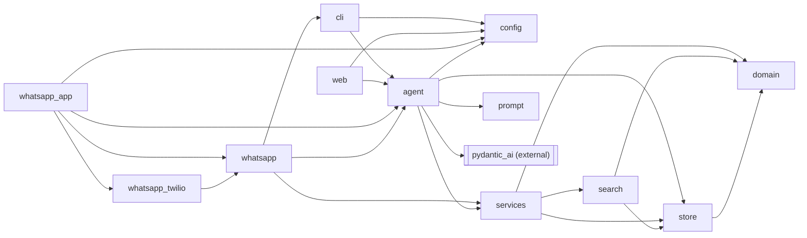
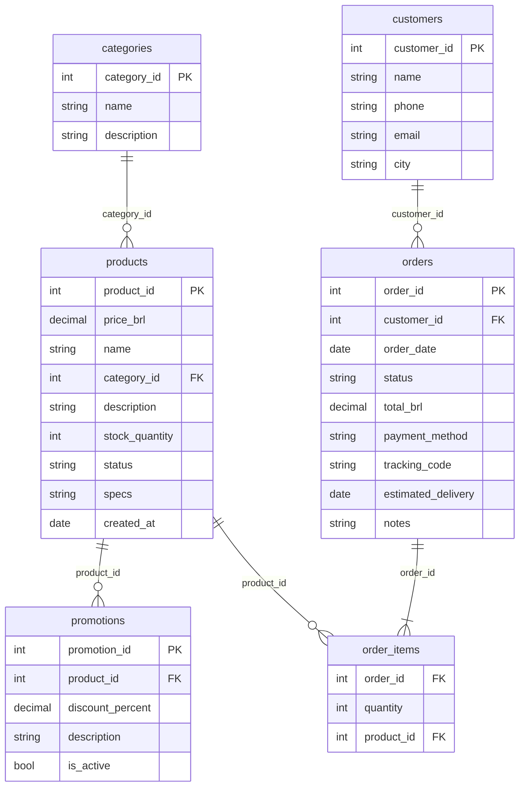

# emporio-agent

## TL;DR

- Mel is a text customer-service agent for Empório da Música, a fictional instrument store in Campo
  Grande/MS: store persona, PT-BR (or English) replies, polite refusal of out-of-scope requests.
- One PydanticAI agent, four deterministic tools (product search, policy section, order lookup,
  handoff). The tools compute every price, stock figure, deadline and order fact; the prompt forbids
  stating one without a tool result, and the scenario checks trace every `R$` amount to a tool.
- "The simplest way possible" was read as that minimal core, with optional extras such as the
  WhatsApp channel off by default. "All responses in English" was read as code, docs and this
  README in English, while Mel answers customers in their language (PT-BR by default).

## Approach

The order in which the problem was worked, each step linked to where it is detailed:

1. **Read the material before writing code.** The brief, the manual and the CSVs disagree in 20
   places; each got one documented assumption ([Data inconsistencies](#data-inconsistencies)), and the
   manual was transcribed once into `data/politicas.md` instead of being parsed at runtime.
2. **Decide what the model must not do.** Prices, installments, return windows, opening hours and
   order access must be exact, so they live in plain, unit-tested code (`domain.py`, `services.py`).
   The model only picks one of four tools and phrases the answer. That ruled out RAG and text-to-SQL
   ([Decisions](#decisions)).
3. **Treat identity as a security boundary.** Order data needs the order number plus that customer's
   phone or e-mail on every call, and nothing about a customer is kept between calls.
4. **Choose by evidence.** The framework came from a sourced comparison
   (`docs/research/2026-11-02-python-agent-framework.md`); the model from a live comparison with
   the selection rule fixed before the run ([Spike results](#spike-results)).
5. **Make behaviour checkable.** Scripted scenarios run on the real model with automatic checks
   (tools called, every `R$` amount traced to a tool, no leaks), and only a passing run writes the
   [example conversations](#example-conversations).
6. **Review against the brief, then fix.** Two independent evaluations against the challenge
   criteria found real gaps (a masked protocol number, unrequested handoffs, a wrong opening-hours
   sentence, a hard-to-read README), each fixed before delivery.
7. **Keep extras optional.** The core is one agent and four tools; the WhatsApp channel is off by
   default ([Optional extra](#optional-extra-whatsapp-channel)).

## Quickstart

With [uv](https://docs.astral.sh/uv/) and Python 3.12 (`.python-version`), run `uv sync` and
`cp .env.example .env`, then set in `.env`:

- `OPENROUTER_API_KEY`: your key, from https://openrouter.ai/keys.
- `MODEL` (optional): any `openrouter:<provider>/<model>` id (default
  `openrouter:deepseek/deepseek-v4.1-flash`).
- `EMPORIO_NOW` (optional): the store clock for every date rule (return windows, order delay, "open
  now"): ISO 8601 with offset (default `2026-03-25T10:00-04:00`) or `now` for the real clock.

Run from the repo root (`.env` is read there):

- CLI: `uv run python -m emporio.cli`
- Web chat UI: `uv run uvicorn emporio.web:app --host 127.0.0.1 --port 7932`, then
  http://127.0.0.1:7932
- Tests: `uv run pytest` never calls an LLM (PydanticAI's `TestModel` / `FunctionModel`);
  `uv run pytest -m live` runs the five scenarios on the real model (skipped without the key).
- `uv run python scripts/scenarios.py`: five scripted scenarios live at temperature 0, auto-checked
  (tool trajectory, `R$` amounts traced to tools) into `examples/01-…` to `05-…`; spends credits.
- `uv run python scripts/spike.py` compares candidate models live into `docs/spike-results.md`.

Validation, the same commands CI runs:
```bash
uv sync --frozen
uv run --frozen ruff check .
uv run --frozen ruff format --check .
uv run --frozen pytest -q
```

## Example conversations

- [`examples/01-catalog-search.md`](examples/01-catalog-search.md): guitars up to R$ 1000, then electro-acoustics up to R$ 1000 by PIX price.
- [`examples/02-price-payment-and-store-info.md`](examples/02-price-payment-and-store-info.md): Takamine GD20 price and installments, hours, address, payment rules.
- [`examples/03-return-after-regret-window.md`](examples/03-return-after-regret-window.md): a regret return past its window, checked by order lookup, then handed off.
- [`examples/04-late-order.md`](examples/04-late-order.md): a late order with tracking and delay; a second order with the wrong e-mail reveals nothing.
- [`examples/05-out-of-scope.md`](examples/05-out-of-scope.md): accessories refused, an off-topic question, a discount injection and a prompt-leak attempt.

## Architecture

A pure core and a thin shell, imports pointing inward; one agent, four tools, no router. Design
write-up: `docs/superpowers/specs/2026-11-02-emporio-agent-design.md`.

| Module | Role |
|---|---|
| `domain.py` | Frozen dataclasses, value objects (`Money`, `Phone`, `Payment`) and every business rule: effective and PIX price, installments, shipping, return and warranty windows, opening hours. No I/O; time is passed in as `now`. |
| `store.py` | Loads `data/*.csv` and `data/politicas.md` and checks the load-time invariants (foreign keys resolve, at most one active promotion per product). |
| `search.py` | Deterministic product search: accent and typo tolerant, category synonyms, price ceiling, same-category alternatives. |
| `services.py` | The use cases behind the four tools. Returns ready-to-say PT-BR text, enforces order authorization and PII masking. |
| `agent.py` | The PydanticAI `Agent`, the four thin tool wrappers, `Deps` (the clock only) and the `Hooks` capability. The only module that imports PydanticAI. |
| `prompt.py` | Mel's instructions, in four numbered sections that map to the brief's four behaviours. |
| `config.py`, `cli.py`, `web.py` | Stdlib `.env` loading and the `EMPORIO_NOW` clock; thin entry points: a REPL over `agent.run_sync`, and `agent.to_web()` in Starlette. |
| `whatsapp_app.py`, `whatsapp.py`, `whatsapp_twilio.py` | The optional WhatsApp channel: webhook app, channel core (the `Channel` port) and Twilio adapter. |



The data, as loaded by `store.py` (`politicas.md` is text, not a table):


| Tool | What it does |
|---|---|
| `search_products(query, category, max_price)` | Catalog, price, stock and installments. Up to 8 items, available first; a single match returns full detail (specs, promotion or ended promotion, PIX price, max installments). |
| `get_policy(topic)` | One section of `data/politicas.md` (`contact`, `hours`, `payment`, `returns`, `warranty`, `shipping`, `promotions`, `privacy`, `scope`); `hours` also says whether the store is open now. |
| `get_order(order_id, phone_or_email)` | Checks the credentials on every call, then explains status, tracking, delay and return and warranty windows. A wrong credential reads like a missing order; after 5 failures the order is locked. |
| `handoff_to_human(reason, summary)` | Returns a protocol number and appends to `handoffs.jsonl` (gitignored), with PII masked. |

## Decisions

- **Framework: PydanticAI** (`pydantic-ai-slim[openrouter,web]` 2.64.0): native OpenRouter
  provider, a built-in web chat UI, `TestModel` / `FunctionModel` for tests without credits, no
  LiteLLM. Rejected (`docs/research/2026-11-02-python-agent-framework.md`): Google ADK (LiteLLM,
  81 packages), OpenAI Agents SDK (pre-1.0), Vercel `ai` (beta), LangChain/LangGraph (concepts).
- **LLM: OpenRouter only, DeepSeek V4.1 Flash by default.** One key lets the spike compare models
  and a grader swap them via `MODEL`; the spike below picked the default and `max_tokens` 1024.
- **Prompt strategy.** English instructions in `src/emporio/prompt.py` tell Mel to reply in PT-BR
  (English if the customer writes in English), in four numbered sections mapped to the brief's four
  behaviours: 1 Persona, 2 Grounding, 3 Tool routing, 4 Scope. `instructions(now)` prepends the
  weekday, date and time on every run. Enforced in code, not the prompt: credentials on every
  `get_order` call, phone and e-mail masking (`services.mask_text`), every price, PIX price and
  installment from `domain.py`, and the `Hooks` limits. Prompt rules: persona, slogan, emoji, tone,
  no haggling, handoff consent, no partner stores, ignoring injection. Scenarios use temperature 0.
- **Retrieval: whole policy sections by topic, not RAG.** `data/politicas.md` is about 260 lines in
  nine `## [topic]` sections; `store.py` splits on those tags and `get_policy(topic)` returns one
  whole section, routed by exact topic, with no similarity ranking to get wrong. Chunking could
  split linked rules: the section 3 installment table and the section 3.1 tiers that override it
  are both in `[payment]`. Products and orders go through deterministic filters, no embeddings.
- **Policy manual: transcribed once, not parsed at runtime.** `data/politicas_da_loja.pdf` was
  transcribed by hand into `data/politicas.md` (kept in Portuguese, the store's own text) with the
  `## [topic]` tags `get_policy` uses. Where the PDF contradicts itself, the transcription keeps one
  value with a `> Note:` saying why (see Data inconsistencies). Clean, versioned text beats PDF
  extraction at runtime, and each conflict is resolved once, in review, instead of by the model.
- **Price ceiling.** `max_price` compares against the lowest payable price: the PIX price, or the
  promotional price when a promotion is active (PIX does not stack on it). So in
  `examples/01-catalog-search.md` the R$ 1.049,00 guitar (R$ 996,55 via PIX) is "até R$ 1000".
- **A pure core, no ports or DTOs**: plain functions over frozen dataclasses in `domain.py`, tested
  without mocks; the one port, `whatsapp.Channel`, has a second adapter (Meta) planned.
- **Stateless order verification**: credentials checked per call, `deps` holds only the clock, as
  `to_web()` shares one `deps` across conversations. **Regex masking**: handoff text is free-form.
- **Limits in `Hooks`, not `UsageLimits`** (`to_web()` takes none): messages over 2,000 characters
  are rejected, a turn stops after 10 model requests, a conversation stops at 40,000 characters.
- **Non-goals:** multi-agent; text-to-SQL (could read any customer's rows); storing conversations
  on disk (PII; history stays in memory: CLI, browser tab, or WhatsApp per-sender); a hand-written
  chat API (the only custom endpoint is the optional WhatsApp webhook); a custom UI (the built-in
  one is enough); Docker; write operations.

## Spike results

`scripts/spike.py` ran the real agent on nine scripted turns on 2026-11-03 (per-turn rows:
[`docs/spike-results.md`](docs/spike-results.md)). DeepSeek wins on the rule (both checks, then
accuracy, latency, cost); Gemini ties on accuracy but is about 5x slower, Sonnet missed a follow-up.

| Model | Tool accuracy | Args valid | Median latency (s) | Total cost (USD) | History valid | Stopped turn OK |
|---|---|---|---|---|---|---|
| openrouter:google/gemini-3.8-flash | 100% | 100% | 11.16 | 0.04589 | yes | yes |
| openrouter:anthropic/claude-sonnet-5.5 | 89% | 89% | 4.61 | 0.10114 | yes | yes |
| openrouter:deepseek/deepseek-v4.1-flash | 100% | 100% | 2.21 | 0.00397 | yes | yes |

## Data inconsistencies

Most rows are asserted by `tests/test_store.py` (data) or noted in `data/politicas.md` (manual).

| Inconsistency | Adopted assumption |
|---|---|
| Contact: the manual gives (67) 3341-4444 as "Telefone / WhatsApp" (1.2), but section 7 names (67) 3321-4500 as the WhatsApp channel. | 3341-4444 is the phone line, 3321-4500 is WhatsApp. |
| The store e-mail is spelled with an accent in 1.2 (`contato@empóriodamusica.com.br`) and without one on the cover. | The unaccented address is used. |
| Installments: the summary table in section 3 disagrees with the tiers in section 3.1. | Section 3.1 wins: up to 3x with no minimum, 4x–6x at least R$ 80,00, 7x–12x at least R$ 100,00. |
| "Exceto abaixo de R$ 50,00" is ambiguous. | Purchases below R$ 50 are not split into installments. |
| The manual says "mais de 300 instrumentos"; the catalog has 65 products. | Mel never quotes a catalog size. |
| The woodwind, brass and orchestral strings categories have no products. | Mel says nothing is available in the system right now, not "we don't sell it". |
| The manual says to suggest partner stores, but no partner list exists. | No partner store is ever named. |
| Product 136 is `discontinued` but has stock 13. | Status beats stock: shown as "fora de linha", plus alternatives. |
| Product 130 is `coming_soon` but was sold in orders 3 and 14. | Status wins for new sales; past orders are reported as recorded. |
| Product names contradict their descriptions in products 135–144 (visible only in the data). | Name and specs are the source of truth; descriptions are never returned. |
| Product 96 is `active` with stock 0. | Shown as unavailable, plus same-category alternatives. |
| Orders 9, 16 and 18 use more installments than the minimums allow. | Reported as recorded; the rules apply to new quotes only. |
| PIX orders 1, 5, 10, 13 and 17 carry no 5% PIX discount. | Totals are reported as-is, never recomputed. |
| Order 11 ignores the active promotion on its product (127). | The total is reported as-is. |
| The totals of orders 3 and 20 differ from the sum of their items. | Totals are reported as-is ("order value"). |
| Campo Grande (metro) deliveries carry Correios-style tracking codes, though the manual says metro orders go by motoboy. | The carrier is never stated; only the tracking code is given. |
| Customers 11 and 43 share the e-mail `bruno.martins@jmail.com`. | Verification is anchored on the order's customer. |
| There is no delivered-at column. | `estimated_delivery` stands in for the delivery date in return and warranty windows. |
| There is no sales-channel column, but the regret right applies only to online purchases. | All orders are treated as online. |
| The manual does not say when the 7-day exchange-by-preference window starts. | It starts at delivery. |

## Considered and rejected: input guardrail classifier

Code already enforces what it would protect (credentials per call, no write tools, no contact
details in tool results, size caps); it would add a model call per message, misfire on short PT-BR
like "violao?", and either fail closed (blocking customers) or open (protecting nothing).

## Limitations

- Web UI: provider errors reach the browser as `str(error)`; the front end loads from a CDN (local
  use only). Holidays are not modelled in "open now".
- The 5-failure order lock and all history are in memory only (process or browser tab): lost on
  restart, not shared. WhatsApp limits are in "Optional extra: WhatsApp channel".
- Shipping outside Campo Grande is never quoted (no CEP lookup); the manual's return exclusions
  have no data flag, so Mel states them as conditions.

## Scaling

| Growth axis | Bottleneck today | What changes | What stays |
|---|---|---|---|
| Catalog (65 → 100k products) | CSVs in memory, `difflib` search | `store.py` reads Postgres; search becomes hybrid (full-text plus embeddings) | `domain.py`, the `search_products` signature, the prompt |
| Knowledge (one manual → many documents) | `get_policy` serves 9 fixed topics | RAG enters here: chunks by section with metadata, hybrid retrieval and reranking | "Only answer from a source" |
| Traffic | Failure lock and handoffs in process memory and a file | Stateless verification scales horizontally; the lock moves to Redis; handoffs go to a queue | Tools, prompt, rules |
| Domains (4 → 30 tools) | One agent starts picking the wrong tool | A cheap router in front of specialists, when the spike harness shows tool accuracy dropping | Specialists reuse `services` |
| Channels | CLI, web UI and WhatsApp, history in process memory | More adapters on `whatsapp.Channel` (Meta next); history in an encrypted store; tools as an MCP server | The agent itself |
| Multiple stores | One store's data and persona | A tenant id in `deps`, data, persona and manual per store | The rule code |
| Quality and cost | Spike and scenarios run by hand | Scheduled regression runs with pass rates; OpenTelemetry traces; model routing | The harness |

## Next steps

- Persistence for conversations and handoffs, with PII controls (encryption, retention) for LGPD.
- RAG over the manual if it grows beyond what whole sections by topic can serve.
- An MCP server exposing the four tools if a back-office tool needs them.
- A real handoff system (ticketing or a live-agent queue) instead of `handoffs.jsonl`.
- OpenTelemetry via PydanticAI's instrumentation for traces, token use and tool latency.

## AI-assistant workflow

Built with **Claude Code** (Claude Opus as the main model). The author made the product and design
calls; the assistant did the research, the code and the reviews, through these stages:

1. **Design.** A brainstorming session over the brief, the manual and the CSVs produced the design
   spec (`docs/superpowers/specs/`). Two "grilling" rounds then had the assistant question each
   decision until it was justified or cut, and a separate Opus agent re-checked the answers.
2. **Research.** A research agent compared Python agent frameworks against primary sources
   (`docs/research/2026-11-02-python-agent-framework.md`); a later one did the same for WhatsApp
   integration (`docs/research/2026-11-03-whatsapp-integration.md`).
3. **Plan.** The spec was cut into user stories (`tasks/prd-emporio-agent.md`), one GitHub issue each.
4. **Build: a local "software factory" of agents**, one pull request per issue:

   ```mermaid
   flowchart LR
       issue[GitHub issue] --> intake --> spec[spec-writer] --> builder
       builder --> gate{"checks: ruff, format, pytest"}
       gate -- fail --> builder
       gate -- pass --> reviews["reviewers in parallel: code, plus security / UX / UI by risk"]
       reviews -- changes --> builder
       reviews -- all pass --> approver{approver}
       approver -- approve --> merge[merge commit]
       approver -- escalate --> human[author decides]
       human -- feedback --> builder
   ```

   - **Intake** (Opus) accepts, rescopes or rejects the issue and rates its risk; **spec-writer**
     (Opus) turns it into testable acceptance criteria; **builder** (Opus) implements it on its own
     branch and git worktree and opens a draft PR.
   - **Gate:** the same commands as CI; a failing build never reaches review. Existing tests are a
     protected path, so a build cannot pass by editing them; new behaviour gets new test files.
   - **Reviewers** are routed by risk: a code reviewer always (Haiku or Sonnet), a security
     reviewer (Opus) for anything touching identity, PII or a public endpoint, UX and UI reviewers
     for interface changes. At most three build rounds per issue.
   - **Approver** (Opus) merges only low-risk work. Anything touching the persona prompt, the
     graded examples, the default model, a dependency, CI or access control is escalated to the
     author with a written decision; the author answers with feedback or a go-ahead.
   - **Guardrails:** agents never read `.env`; live runs load the key in a subshell with a spend
     cap; an agent's report was checked against the branch diff and the gate before moving on.
5. **Evaluate.** Two independent evaluator agents graded the repo against the brief's criteria;
   their findings became issues and went through the same pipeline.

Result: 15 issues and 28 merged pull requests, all merge commits. The reviews caught real defects:
a conversation-size cap that reasoning parts could bypass, accent-sensitive name masking,
README claims the code did not back, unrequested handoffs and a wrong opening-hours sentence.
Live runs also failed honestly: when the model kept misplacing an emoji, the build stopped as
BLOCKED and the author changed the rule instead of the check being loosened silently.

**Checked by hand:** the five transcripts were read before merging, and a two-tab check in the
web UI held: tab B asked for order 8's tracking code with no credentials and Mel revealed nothing.

## Credits and notices

- Some ideas came from [AlvarDev/sre-genai](https://github.com/AlvarDev/sre-genai); no code copied.
- The store data in `data/` is fictional and was provided by the challenge.

## Optional extra: WhatsApp channel

A Twilio webhook app, `emporio.whatsapp_app`, separate from the chat UI: it serves only
`POST /whatsapp/twilio`, and only when the four `TWILIO_*` variables are set. Detail:
`docs/research/2026-11-03-whatsapp-integration.md`. Without a WhatsApp account,
`uv run python scripts/whatsapp_dryrun.py "Oi, vocês têm violão?"` runs one message through the
same core (real model, spends credits).

1. In the Twilio Console, join the WhatsApp Sandbox (`join <code>` from your phone).
2. Run `uv run uvicorn emporio.whatsapp_app:app --host 127.0.0.1 --port 7933` and tunnel only
   port 7933. **Never tunnel port 7932:** the chat UI has no login, only a `Host` header check
   that a tunnel rewriting `Host` defeats, so anyone could spend your credits.
3. Point "When a message comes in" at `https://<tunnel>/whatsapp/twilio` (POST); in `.env` set that
   URL as `TWILIO_WEBHOOK_URL`, plus the other three `TWILIO_*` variables, and restart.

Known limitations: replay (signatures carry no timestamp; the dedupe keeps only the last 1,000
`MessageSid`s), recycled numbers (history is kept per number for 24 h, so a new holder continues
the old conversation), the Sandbox may not send to Brazil (+55), and history is in memory only.
