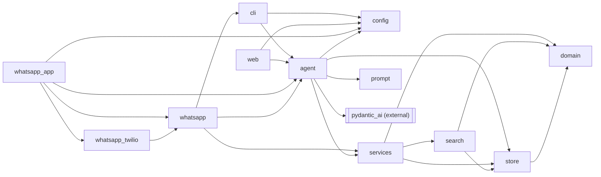
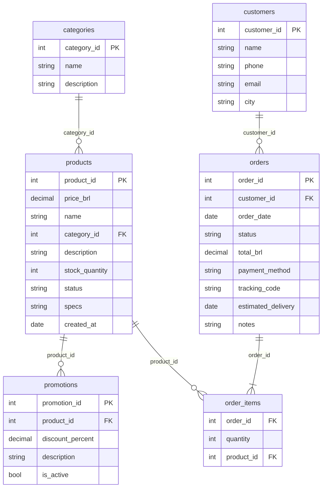

# emporio-agent

Mel is a text customer-service agent for Empório da Música, a fictional musical-instrument
store in Campo Grande/MS, built for the Artefact AI Engineer take-home. She keeps the store's
persona (PT-BR, or English if the customer writes in English), answers only from the product
data in `data/*.csv` and the store manual in `data/politicas.md`, decides when to query data
(catalog, price, stock, order status) and when to read the policy manual (returns, hours,
payment, shipping), and turns away out-of-scope requests politely. Every price, stock figure,
deadline and order fact she states comes from one of four deterministic tools; the model never
does arithmetic. The full design write-up is
`docs/superpowers/specs/2026-11-02-emporio-agent-design.md`.

## Run steps

Prerequisites: [uv](https://docs.astral.sh/uv/) and Python 3.12 (`.python-version`; uv
installs it if missing).

```bash
uv sync
cp .env.example .env   # holds OPENROUTER_API_KEY, MODEL and EMPORIO_NOW
```

Set `OPENROUTER_API_KEY` (from https://openrouter.ai/keys) and, optionally, `MODEL` in `.env`.
`EMPORIO_NOW` sets the store clock: ISO 8601 with offset (default `2026-03-25T10:00-04:00`, a
Wednesday three days after the last order in the data) or `now` for the real clock at `-04:00`.
It drives every date rule: return windows, order delay, "are we open now".

Two interfaces, run from the repo root (both read `.env` there):

- CLI: `uv run python -m emporio.cli`
- Web chat UI (PydanticAI `to_web`):
  `uv run uvicorn emporio.web:app --host 127.0.0.1 --port 7932`, then open
  http://127.0.0.1:7932

Tests:

- `uv run pytest` runs the unit, authorization and agent-wiring tests. Unit tests never call an
  LLM: the agent is driven by PydanticAI's `TestModel` / `FunctionModel`, so they need no key and
  run in CI.
- `uv run pytest -m live` runs the six scripted scenarios against the real model as a test. It
  is deselected by default and skipped without `OPENROUTER_API_KEY`.

Scenarios: `uv run python scripts/scenarios.py` runs Mel's six scripted conversations live on
the default model at temperature 0 and checks each one (tool trajectory, forbidden content, and
that every `R$` amount Mel states appeared earlier in a tool result or a customer message). It
spends OpenRouter credits. It writes `examples/01-…` to `05-…` for the scenarios that pass (the
sixth is a test only). The transcripts in `examples/` are generated by this script and never
edited by hand.

Model spike: `uv run python scripts/spike.py` compares the candidate models live and writes
`docs/spike-results.md` (also generated, also spends credits).

The full validation, the same commands CI runs:

```bash
uv sync --frozen
uv run --frozen ruff check .
uv run --frozen ruff format --check .
uv run --frozen pytest -q
```

## WhatsApp channel

Mel can also answer on WhatsApp through Twilio. The webhook runs as its own app,
`emporio.whatsapp_app`, separate from the chat UI. It serves only `POST /whatsapp/twilio`, and
only when the four `TWILIO_*` variables in `.env` are all set; otherwise it answers 404. On each
incoming message it:

- answers 413 to a body over 64 KB, before reading the rest and before the signature check;
- checks the `X-Twilio-Signature` header (HMAC-SHA1 over `TWILIO_WEBHOOK_URL` and every form
  field) and answers 403 on a bad or missing signature;
- acknowledges at once with an empty `<Response/>`, ignoring a repeated `MessageSid`, then runs
  Mel in the background and sends the reply through Twilio's Messages API, with `**bold**`
  turned into WhatsApp's `*bold*`, headings stripped and long replies split into parts of at
  most 1,000 characters;
- keeps each sender's history in memory, one turn at a time per sender, and forgets it after
  24 h without messages; after the conversation-size limit message the next message starts a
  fresh history;
- answers a photo, audio, location or any other non-text message with a fixed text-only reply,
  without calling the model.

The sender's phone number never reaches Mel: order lookups still need the order number and the
phone or e-mail the customer types. Phone numbers are masked in every `[whatsapp]` log line.

Connecting the Twilio Sandbox:

1. In the Twilio Console, open the WhatsApp Sandbox and send `join <code>` from your phone to
   the Sandbox number.
2. Run the webhook app on its own port
   (`uv run uvicorn emporio.whatsapp_app:app --host 127.0.0.1 --port 7933`) and expose only that
   port through an HTTPS tunnel (any tunnel tool). Never point the tunnel at the chat UI's port
   (7932): the chat UI has no login, and its only protection is PydanticAI's check that the
   `Host` header is localhost or an IP. A tunnel that rewrites the `Host` header (for example
   ngrok's `--host-header=rewrite`) defeats that check, so anyone with the URL could chat with
   Mel and spend your OpenRouter credits. The webhook app has no chat UI.
3. Set "When a message comes in" to `https://<tunnel>/whatsapp/twilio`, method POST.
4. In `.env`, set `TWILIO_ACCOUNT_SID`, `TWILIO_AUTH_TOKEN`, `TWILIO_WHATSAPP_FROM` (the Sandbox
   number, as `whatsapp:+14155238886`) and `TWILIO_WEBHOOK_URL`, exactly the URL from step 3.
   The signature is checked against that URL, never the one the server sees behind the tunnel.
   Restart the server.

Without any WhatsApp account, `uv run python scripts/whatsapp_dryrun.py "Oi, vocês têm violão?"`
feeds one message through the same core and prints Mel's reply parts as `Mel: …`. It calls the
real model, so it needs `OPENROUTER_API_KEY` and spends credits.

Twilio says the Sandbox number "might be temporarily restricted from sending to certain
countries, such as Brazil", so replies to +55 numbers may fail; test with your number first.
The planned fallback is a Meta WhatsApp Cloud API adapter on the same core (`whatsapp.Channel`).

Known limitations:

- Replay: a Twilio signature has no timestamp, and the dedupe remembers only the last 1,000
  `MessageSid`s in memory. Someone who captured a signed request can replay it once its id has
  left that window (or after a restart); Mel then answers it again, to the original sender.
- Recycled numbers: history is kept per phone number for up to 24 h after the last message, so
  if a number changes hands within that window, the new holder's messages continue the previous
  holder's conversation, including any order details looked up in it.

Out of scope for now: the Meta adapter, message templates and re-engaging a customer after the
24-hour window, media handling, persisting history, and using the sender's phone number as the
order credential.

## Model choice

The model is whatever `MODEL` in `.env` says. Any PydanticAI OpenRouter id works, in the form
`openrouter:<provider>/<model>`, for example `openrouter:google/gemini-3.8-flash`. Nothing else
changes: the tools, prompt and limits are model-independent. The default, in `.env.example` and
as the fallback in `src/emporio/agent.py`, is `openrouter:deepseek/deepseek-v4.1-flash`, picked
by the spike below. Output is capped at `max_tokens` 1024, also set from the spike.

## Architecture

The design has two separate axes: how the code is structured, and how the agent decides what
to do.

### Code structure: pure core, thin shell

Hexagonal in spirit, without the ceremony: a pure functional core and a thin imperative shell,
with no DTOs and no composition root, and a single `Protocol` port, `whatsapp.Channel`, because
there the same core serves several messaging providers. Dependencies point inward only.

| Module | Role |
|---|---|
| `domain.py` | Frozen dataclasses, enums, value objects (`Money`, `Phone`, `Payment`) and every business rule: effective and PIX price, installments, shipping, return and warranty windows, opening hours. No I/O; time is always passed in as `now`. |
| `store.py` | Loads `data/*.csv` and `data/politicas.md` into domain objects and checks the load-time invariants (every foreign key resolves, at most one active promotion per product). |
| `search.py` | Deterministic product search: accent and typo tolerant, category synonyms, price ceiling, same-category alternatives. |
| `services.py` | The use cases behind the four tools. Returns ready-to-say PT-BR text, enforces order authorization and PII masking. |
| `agent.py` | The PydanticAI `Agent`, the four thin tool wrappers, `Deps` (the clock only) and the `Hooks` capability. The only module that imports PydanticAI. |
| `prompt.py` | Mel's instructions, in sections F1 to F4 that map to the challenge's criteria. |
| `config.py` | Stdlib only: loads `.env` (real env vars win) and turns `EMPORIO_NOW` into the clock. |
| `cli.py`, `web.py` | Thin entry points: a REPL over `agent.run_sync`, and `agent.to_web()` mounted in Starlette. |
| `whatsapp_app.py` | The webhook-only Starlette app: `POST /whatsapp/twilio` when Twilio is configured, nothing else. The one app meant to be exposed through a tunnel. |
| `whatsapp.py` | The WhatsApp channel core: the `Channel` port, in-memory history per sender, dedupe, per-sender locks, reply formatting and one agent turn per message. No PydanticAI import. |
| `whatsapp_twilio.py` | The Twilio adapter for `Channel`: signature check against `TWILIO_WEBHOOK_URL`, form parsing, and sending through the Messages API. Stdlib and Starlette only. |

Module imports inside `src/emporio/`:



The data, as loaded by `store.py` (`politicas.md` is text, not a table):



### Agent control flow: one agent, four tools

One PydanticAI agent with four tools. There is no router, no planner and no multi-agent setup:
the model reads the tool docstrings (each says when to use the tool and when not to) and picks.

| Tool | What it does |
|---|---|
| `search_products(query, category, max_price)` | Catalog, price, stock and installments. Up to 8 items, available first; a single match returns full detail (specs, promotion or ended promotion, PIX price, max installments). |
| `get_policy(topic)` | One section of `data/politicas.md` (`contact`, `hours`, `payment`, `returns`, `warranty`, `shipping`, `promotions`, `privacy`, `scope`); `hours` also says whether the store is open now and when it next opens. |
| `get_order(order_id, phone_or_email)` | Checks the credentials on every call, then explains the order's status, tracking, delay and return and warranty windows. A wrong credential or another customer's order reads like a missing order; after 5 failures the order is locked and Mel offers a human. |
| `handoff_to_human(reason, summary)` | Returns a protocol number and appends to `handoffs.jsonl` (gitignored), with PII masked. |

A single `Hooks` capability on the `Agent` guards the loop, so the same limits hold in the CLI,
the web UI and the scenarios:

- a customer message over 2,000 characters is rejected before any model call;
- a turn stops after 10 model requests with a fixed PT-BR message giving the WhatsApp number
  and opening hours;
- a conversation whose total text is over 40,000 characters stops with a fixed message asking
  the customer to start a new conversation (the web UI resends the whole history every turn,
  so this bounds the cost of each turn);
- every tool call is logged to stderr with masked, truncated arguments, and each turn's
  requests and tokens are logged at the end.

## Decisions

Each decision with the alternatives that were rejected. Sources:
`docs/superpowers/specs/2026-11-02-emporio-agent-design.md` and the framework research in
`docs/research/2026-11-02-python-agent-framework.md`.

- **PydanticAI as the agent framework** (`pydantic-ai-slim[openrouter,web]`, pinned to
  2.64.0). It has a native OpenRouter provider, a built-in web chat UI, typed tool-call parts
  that keep trajectory assertions short, `TestModel` / `FunctionModel` for tests without
  credits, and the slim install pulls no LiteLLM. Rejected:
  - Google ADK: needs LiteLLM for OpenRouter (81 packages).
  - OpenAI Agents SDK: Responses API by default, tracing to OpenAI, pre-1.0.
  - Vercel `ai` for Python: beta, no OpenRouter path.
  - LangChain/LangGraph: more concepts to explain, OpenRouter package in beta.
  - The fallback, a plain `openai` SDK loop, was kept only in case the spike failed; it didn't.
- **OpenRouter only.** One key and one provider let the spike compare Gemini, Claude and
  DeepSeek by changing a string, and let a grader swap the model the same way. Direct provider
  SDKs were rejected as extra code for no gain in a prototype.
- **A pure core without `Protocol` ports or DTOs.** The rules live in `domain.py` as plain
  functions over frozen dataclasses, tested without mocks. Full hexagonal ports, DTOs and a
  composition root were rejected as ceremony: there is one adapter per port and no second one
  coming. The exception is `whatsapp.Channel`, where a second adapter (Meta) is planned.
- **Stateless order verification; `deps` holds only the clock.** `get_order` takes the order
  number plus the phone or e-mail on that order and checks them on every call; no tool accepts
  a customer id, and nothing about the customer is kept between calls. The customer's own
  credentials stay in their conversation history, so the model re-sends them on a follow-up.
  Rejected: a "verified customer" flag in `deps` (the web UI's `to_web()` shares one `deps`
  object across all conversations, so it would leak between customers) and server-side history
  (it would store customer PII on disk, against LGPD and the manual's privacy section).
- **Limits in a `Hooks` capability, not `UsageLimits`.** `UsageLimits` is passed per run, but
  `to_web()` takes no usage limits (a web run would fall back to PydanticAI's default of 50
  requests). Hooks registered on the `Agent` apply in every interface.
- **Regex masking, not masking by field name.** Phones and e-mails are masked by a regex over
  every string argument in logs, `handoffs.jsonl` and transcripts (`***3456`,
  `l***@jmail.com`). Masking by field name was rejected because `handoff_to_human`'s `reason`
  and `summary` are free text written by the model and may carry a name, phone or e-mail.
- **Non-goals, each considered and cut:**
  - Router or multi-agent setup: four tools on one agent route fine; a router adds a model call
    and a failure point.
  - RAG or embeddings: the manual is short enough to serve whole sections by topic.
  - Text-to-SQL: model-written queries could read any customer's rows; deterministic tools keep
    authorization in code and are unit-tested.
  - Persistent sessions: they would store PII server-side; history lives in the CLI process or
    the browser tab.
  - Custom web API: PydanticAI's `to_web()` already serves a chat endpoint.
  - Docker: `uv sync` plus `.python-version` already gives a reproducible setup.
  - Custom UI: the built-in web chat UI is enough for a prototype.
  - Write operations (cart, order changes, returns): Mel explains eligibility and hands off to a
    human; she never changes data.
  - Purchase simulator: purchase intent ends in price, conditions and a handoff to close the
    sale.
  - Guardrail classifier model: see "Considered and rejected" below.
  - Holiday calendar: the manual closes on holidays but lists no dates, so a calendar would be
    guesswork.
  - Local models: they would need hardware and setup a grader may not have; OpenRouter already
    covers model choice with one key.

## Spike results

Before picking a default, `scripts/spike.py` ran the real agent (actual tools and prompt) on
nine scripted turns (price, catalog with ceiling, hours, return, accessory, off-topic,
injection, and a two-turn order follow-up) against three models on OpenRouter, run on
2026-11-03 with `EMPORIO_NOW=2026-03-25T10:00-04:00`. Summary of the "Per model" table; the
per-turn rows are in [`docs/spike-results.md`](docs/spike-results.md):

| Model | Tool accuracy | Args valid | Median latency (s) | Total cost (USD) | History valid | Stopped turn OK |
|---|---|---|---|---|---|---|
| openrouter:google/gemini-3.8-flash | 100% | 100% | 11.16 | 0.04589 | yes | yes |
| openrouter:anthropic/claude-sonnet-5.5 | 89% | 89% | 4.61 | 0.10114 | yes | yes |
| openrouter:deepseek/deepseek-v4.1-flash | 100% | 100% | 2.21 | 0.00397 | yes | yes |

Selection rule: among models whose history check and stopped-turn check both pass, take the
highest tool accuracy, then the lower median latency, then the lower total cost.

Default model: `openrouter:deepseek/deepseek-v4.1-flash`. It passes both checks with accuracy
100%, median latency 2.21 s and total cost 0.00397 USD; Gemini ties on accuracy but is about
5x slower, and Claude Sonnet missed the second order follow-up. The spike also set
`max_tokens` to 1024 (twice the default's largest single response, 510 tokens, rounded up to a
multiple of 512) and kept the request limit at 10 (the largest turn used 3).

## Data inconsistencies

The manual and the CSVs disagree in places. Most rows below are asserted by
`tests/test_store.py` (data) or noted in `data/politicas.md` (manual); the products 135–144 row
is visible only in the data.

| Inconsistency | Adopted assumption |
|---|---|
| Contact: the manual gives (67) 3341-4444 as "Telefone / WhatsApp" (1.2), but section 7 names (67) 3321-4500 as the WhatsApp channel. | 3341-4444 is the phone line, 3321-4500 is WhatsApp. |
| The store e-mail is spelled with an accent in 1.2 (`contato@empóriodamusica.com.br`) and without one on the cover. | The unaccented address is used. |
| Installments: the summary table in section 3 disagrees with the tiers in section 3.1. | Section 3.1 wins: up to 3x with no minimum, 4x–6x need installments of at least R$ 80,00, 7x–12x at least R$ 100,00. |
| "Exceto abaixo de R$ 50,00" is ambiguous. | Purchases below R$ 50 are not split into installments. |
| The manual says "mais de 300 instrumentos"; the catalog has 65 products. | Mel never quotes a catalog size. |
| The woodwind (Instrumentos de Sopro (Madeiras)), brass (Instrumentos de Sopro (Metais)) and orchestral strings (Cordas Orquestrais) categories have no products. | Mel says nothing is available in the system right now, not "we don't sell it". |
| The manual says to suggest partner stores, but no partner list exists. | No partner store is ever named. |
| Product 136 is `discontinued` but has stock 13. | Status beats stock: shown as "fora de linha" (no longer in the catalog), plus alternatives. |
| Product 130 is `coming_soon` but was sold in orders 3 and 14. | Status wins for new sales (shown as "em breve", not sold, stock not quoted); past orders are reported as recorded. |
| Product names contradict their descriptions in products 135–144. | Name and specs are the source of truth; descriptions are never returned. |
| Product 96 is `active` with stock 0. | Shown as unavailable, plus same-category alternatives; no reservation promised. |
| Orders 9, 16 and 18 use more installments than the minimums allow. | Orders are reported as recorded; the rules apply to new quotes only. |
| PIX orders 1, 5, 10, 13 and 17 carry no 5% PIX discount. | Totals are reported as-is, never recomputed. |
| Order 11 ignores the active promotion on its product (127). | The total is reported as-is. |
| The totals of orders 3 and 20 differ from the sum of their items. | Totals are reported as-is ("order value"). |
| Campo Grande (metro) deliveries carry Correios-style tracking codes, though the manual says metro orders go by the store's own motoboy. | The carrier is never stated; only the tracking code is given. |
| Customers 11 and 43 share the e-mail `bruno.martins@jmail.com`. | Verification is anchored on the order: the phone or e-mail must match that order's customer. |
| There is no delivered-at column. | `estimated_delivery` stands in for the delivery date in return and warranty windows. |
| There is no sales-channel column, but the regret right applies only to online purchases. | All orders are treated as online. |
| The manual does not say when the 7-day exchange-by-preference window starts. | It starts at delivery. |

## Considered and rejected: input guardrail classifier

A separate model that classifies each customer message (off-topic, injection, abuse) before
Mel sees it was considered and rejected. What it would protect is already enforced in code:
order data needs valid credentials in the same `get_order` call, no tool changes order or
customer data or accepts a customer id (the only write is the handoff record), tools never
return a customer's phone, e-mail or full name, and the `Hooks` capability caps input size,
requests per turn and conversation length, so a successful injection can at worst produce an
off-brand reply or a spurious handoff record. It would add one more model call per turn, in
series, before Mel can start, adding latency and cost to every message. It gives false
positives on the short, unaccented PT-BR messages customers actually send, like "violao?". And
it forces a choice between failing closed (a classifier outage or false positive blocks real
customers) and failing open (an outage lets everything through, so it protected nothing). If
the logs ever show a need, the next step would be a fail-open structured-output classifier
with logging, behind a labelled eval set that measures its false-positive rate on real PT-BR
traffic before it gates anything.

## Limitations

- In the web UI, an error raised by the provider (bad key, rate limit, outage) reaches the
  browser unformatted, as `str(error)`; the CLI turns it into a generic PT-BR message and logs
  the details.
- Holidays are not modelled: "open now" and "next opening" follow the weekly hours only.
- The 5-failure lock on an order lives in the process, so it resets on restart and is not shared
  between processes.
- Conversation history lives in memory only (the CLI process, or the browser tab in the web
  UI); closing it loses the conversation.
- WhatsApp history, the `MessageSid` dedupe and the per-sender locks live in one server
  process's memory, so they are lost on restart and not shared between processes. Replay and
  recycled-number limits are listed in "WhatsApp channel".
- The web UI front end loads from a CDN and is meant for local development, not production.
- Shipping outside Campo Grande is never quoted (no CEP lookup); Mel says it needs a quote by
  CEP and never invents a value.
- The manual's return exclusions (custom setups, "venda final", mouthpieces) have no data flag,
  so Mel states them as conditions instead of checking them.

## Scaling

The prototype is not built for scale, because the brief asks for a prototype and scale nobody
needs yet is cost without benefit. It is built so that scaling swaps one layer at a time: the
rules live in `domain.py`, data enters only through `store.py`, and the four tools are the
contract with the model. Each growth axis below changes one layer and keeps the rest, and each
change waits for a measured bottleneck.

| Growth axis | Bottleneck today | What changes | What stays |
|---|---|---|---|
| Catalog (65 → 100k products) | CSVs in memory, `difflib` search | `store.py` reads Postgres; search becomes hybrid (full-text for names and models, embeddings for "a good beginner guitar") | `domain.py`, the `search_products` signature, the prompt |
| Knowledge (one manual → many documents, FAQs, tickets) | `get_policy` serves 9 fixed topics | RAG enters here: chunks by section with metadata, hybrid retrieval and reranking, answers still cite their source | "Only answer from a source" |
| Traffic (many concurrent customers) | Failure lock and handoffs in process memory and a file | Verification is already stateless, so the app scales horizontally; the lock moves to Redis with a TTL plus rate limiting; handoffs go to a queue or ticketing system | Tools, prompt, rules |
| Domains (4 → 30 tools: sales, post-sale, billing, tech support) | One agent with many tools starts picking the wrong one | Multi-agent enters here: a cheap router in front of specialists, each with a few tools and its own prompt (or, first, filtering tools by intent), triggered when the spike harness shows tool accuracy dropping | Specialists reuse the same `services` |
| Channels (WhatsApp, Instagram, website) | CLI, web UI and WhatsApp through Twilio, with history in one process's memory | More adapters on the `whatsapp.Channel` port (Meta Cloud API next) and other channels behind the same webhook pattern; history moves to an encrypted store with retention; the tools are also exposed as an MCP server for the back office | The agent itself |
| Multiple stores | One store's data and persona | A tenant id in `deps`, data filtered per tenant, persona and manual per store | The rule code |
| Quality and cost | Spike and scenarios run by hand, once | Scenarios become a scheduled regression suite with repeated runs and pass rates; OpenTelemetry traces per tool, tokens and cost per conversation; model routing (cheap model for simple turns, stronger one for hard cases) | The spike and scenario harness |

The persona places Mel on the store's WhatsApp channel (manual section 7), and the prototype
now connects to it through Twilio (see "WhatsApp channel"). WhatsApp does not resend the
conversation, so history is kept server-side per phone number; today that is in process memory
with a 24 h idle expiry and a 500-sender cap, and at scale it needs an encrypted store with
retention, for LGPD. The sender's phone number arrives verified by the channel, so it could
later serve as the order credential when it matches the order's customer, while the e-mail path
stays for other cases; the prototype does not do that yet.

## Next steps

- Persistence for conversations and handoffs, with PII controls (encryption, retention,
  access logging) for LGPD.
- RAG over the manual if it grows beyond what whole sections by topic can serve.
- MCP if another channel (WhatsApp, a back-office tool) needs the same tools.
- A real handoff system (ticketing or a live-agent queue) instead of `handoffs.jsonl`.
- OpenTelemetry via PydanticAI's instrumentation (Logfire or any OTel backend) for traces,
  token use and tool latency.

## AI-assistant workflow

The project was built with Claude Code as the assistant, in these stages:

- **Brainstorming:** the design spec
  (`docs/superpowers/specs/2026-11-02-emporio-agent-design.md`) came out of a brainstorming
  session with the assistant over the challenge brief, the store manual and the CSVs.
- **Grilling:** the spec then went through two grilling rounds, where the assistant questioned
  each decision until it was justified or cut (recorded in the spec's status line).
- **Opus review agents:** each pull request is reviewed by reviewer agents before approval
  (an Opus security reviewer on every sensitive change, an Opus approver on every PR). Before
  any code, an Opus agent also reviewed the grilling answers and judged which ideas from
  AlvarDev/sre-genai were worth adopting. Review passes changed real things: accent-insensitive
  name masking, a conversation-size cap that counts every message part, and a prompt fix after
  the live scenarios showed Mel handing off returns and late orders without looking them up.
- **Research agent:** the framework choice comes from a research agent's report,
  `docs/research/2026-11-02-python-agent-framework.md`, which ranks the candidates with
  sources and lists the gotchas the spike had to confirm.
- **Software factory:** the code was built with a local software factory of Claude Code agents
  (intake, spec, build, gate, reviews, approver), one pull request per GitHub issue. Its
  tooling is not included in this repository. The gate runs the validation commands from "Run
  steps", and a branch reaches review only when they pass.

What was verified, and how:

- The validation commands (ruff, format check and the full offline test suite) passed on every
  factory branch before review; CI runs them on every push and pull request.
- The transcripts in `examples/` come from live runs of `scripts/scenarios.py` that passed their
  automated checks, and `docs/spike-results.md` from a live run of `scripts/spike.py`.
- Checked by hand in the web UI on the default model: Mel answered an opening-hours question via
  `get_policy`, and the two-tab check (spec §16 S5) held. Tab A looked up order 8 with the
  customer's e-mail and got the tracking code; tab B then asked for order 8's tracking code with
  no credentials, and Mel asked for the phone or e-mail and revealed nothing.
- Also by hand: the five transcripts were read before merging (that review caught the missing
  slogan, which led to the slogan and emoji checks), and the Mermaid diagrams were rendered.
- Known gap seen in the live UI: Mel sometimes puts the emoji right after the greeting instead
  of at the end of the message, although the prompt and the scenario check ask for the end.

## Credits and notices

- Some ideas came from [AlvarDev/sre-genai](https://github.com/AlvarDev/sre-genai); no code was
  copied.
- The store data (`data/`: the CSVs and the policy manual) is fictional and was provided by the
  challenge.
